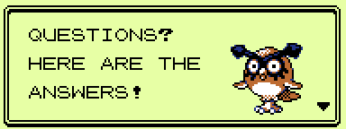

  

# FAQ

Every number here comes from the game's own code (the [pokecrystal disassembly](https://github.com/pret/pokecrystal)) or from the bot's logs at normal speed.

**The basics**
- [Is the stream really live?](#is-the-stream-really-live)
- [Is anyone controlling the bot?](#is-anyone-controlling-the-bot)
- [Is the game modified?](#is-the-game-modified)
- [Is the bot cheating?](#is-the-bot-cheating)
- [What happens if a shiny runs away or faints?](#what-happens-if-a-shiny-runs-away-or-faints)

**The odds**
- [What are DVs?](#what-are-dvs)
- [Why exactly 1 in 8,192?](#why-exactly-1-in-8192)
- [How many encounters does a shiny take?](#how-many-encounters-does-a-shiny-take)
- [What do the percentages mean?](#what-do-the-percentages-mean)
- [How fast is normal speed?](#how-fast-is-normal-speed)
- [What does a shiny's Hidden Power look like?](#what-does-a-shinys-hidden-power-look-like)
- [Why are there no shiny female starters?](#why-are-there-no-shiny-female-starters)
- [How likely is the catch?](#how-likely-is-the-catch)
- [How rare are perfect DVs, almost shinies and four of a kind?](#how-rare-are-perfect-dvs-almost-shinies-and-four-of-a-kind)

**Time**
- [Why is it so slow?](#why-is-it-so-slow)
- [How long will it take?](#how-long-will-it-take)
- [Why does the Bug-Catching Contest take decades?](#why-does-the-bug-catching-contest-take-decades)
- [What are swarms, and why does the bot answer the phone?](#what-are-swarms-and-why-does-the-bot-answer-the-phone)

**The rules**
- [Why no breeding?](#why-no-breeding)
- [What about Pokémon you only meet once?](#what-about-pokémon-you-only-meet-once)
- [Why no Gengar, Machamp or Alakazam?](#why-no-gengar-machamp-or-alakazam)

**The bot**
- [Why does it go back to the same route so often?](#why-does-it-go-back-to-the-same-route-so-often)
- [Why does it run from some wild Pokémon?](#why-does-it-run-from-some-wild-pokémon)
- [Why does it keep fighting Youngster Joey?](#why-does-it-keep-fighting-youngster-joey)
- [Why does the bot catch with a Caterpie and a Zubat in the first section?](#why-does-the-bot-catch-with-a-caterpie-and-a-zubat-in-the-first-section)
- [Can I run the bot myself?](#can-i-run-the-bot-myself)
- [Where do I get notified about shinies?](#where-do-i-get-notified-about-shinies)

## The basics

### Is the stream really live?

Yes. What you see is the game running right now, at normal speed. Nothing is recorded, sped up or cut. The in-game clock follows the real one, so it's night in the game when it's night where the bot runs.

### Is anyone controlling the bot?

No. Once it's started, the bot makes every decision on its own:
- it plays the story;
- it picks where and when to hunt;
- it builds its team, and replaces members when a better shiny comes along;
- it trains, evolves, farms its own money, shops, heals and runs the PC.

Nobody picks a route, a team member or a move during the run. What people decide are the rules it follows, written into its code beforehand, like "no breeding" or "the catcher is always the Butterfree line". The [README](README.md#nobodys-playing-the-bot-decides) lists every decision, and [How it works](HOW-IT-WORKS.md) explains how each one is made.

### Is the game modified?

No. It's an unmodified English Pokémon Crystal. The bot presses buttons and reads the game's memory, the same numbers the game itself uses, and never writes to it.

### Is the bot cheating?

No. Every wild shiny is a real 1 in 8,192 encounter, met by walking, fishing or headbutting like you would. There are no resets for wild Pokémon, no savestates to retry an encounter and no fast-forward. The one exception is the handful of Pokémon the game gives you only once; see [Pokémon you only meet once](#what-about-pokémon-you-only-meet-once). A savestate is used only to recover from a crash of the PC or emulator.

### What happens if a shiny runs away or faints?

It's gone, like it would be for you. The hunt for that Pokémon starts again. The bot does a lot to stop that happening: it puts the shiny to sleep first, never risks a critical hit that could knock it out, and keeps throwing balls; see [How likely is the catch?](#how-likely-is-the-catch)

## The odds

### What are DVs?

Every Pokémon in Gen 2 has four hidden values from 0 to 15, for Attack, Defense, Speed and Special. They make each Pokémon a little stronger or weaker (twice the DV in stat points at Lv 100, so up to 30), and the HP value is built from them too. In Gen 2 they also decide whether a Pokémon is shiny, its gender, its Hidden Power and, for Unown, its letter.

### Why exactly 1 in 8,192?

A Pokémon is shiny when its **Defense, Speed and Special DVs are all 10**, and its **Attack DV is 2, 3, 6, 7, 10, 11, 14 or 15**:

> 1/16 (Defense) × 1/16 (Speed) × 1/16 (Special) × 8/16 (Attack) = **1/8,192**

Each DV is rolled at random when the encounter starts, so every wild Pokémon has the same chance, whatever its species or level.

### How many encounters does a shiny take?

On average **8,192**, but luck swings it a lot. Every encounter is a fresh 1 in 8,192, so the chance to have found one after *n* encounters is 1 − (8,191/8,192)n:

| Chance of at least one shiny | after |
|---|---|
| 50% | 5,678 encounters |
| 63% | 8,192 encounters |
| 90% | 18,863 encounters |
| 99% | 37,726 encounters |

So a hunt three times longer than average isn't bad luck in a meaningful sense: it happens about once in 20 hunts. The overlay calls out droughts once they get rarer than 1 in 10.

That's for *any* shiny. For one particular Pokémon, divide by how often it shows up: a Pokémon in 5% of encounters needs 8,192 ÷ 0.05 = **163,840 encounters** on average.

### What do the percentages mean?

Each patch of grass or cave floor has **seven slots** for each time of day, picked with fixed chances:

> 30% · 30% · 20% · 10% · 5% · 4% · 1%

A Pokémon's percentage is the sum of the slots it fills. Dunsparce in Dark Cave sits only in the last slot: 1% of all encounters there, at any time of day. Teddiursa is in the 5% slot, and only in the morning (4-10 AM). Water has three slots (60/30/10), fishing rods have their own tables, and headbutt trees have a common and a rare table.

| Rarity | Encounters for one shiny, on average | Time at normal speed, non-stop on one route |
|---|---|---|
| 30% | 27,307 | 7.6 days |
| 20% | 40,960 | 11.4 days |
| 10% | 81,920 | 23 days |
| 5% | 163,840 | 46 days |
| 4% | 204,800 | 57 days |
| 1% | 819,200 | 228 days |

A Pokémon that only appears at one time of day takes longer by that much: morning is 6 of the day's 24 hours, so a morning-only 5% Teddiursa needs about **213 mornings** in Dark Cave.

### How fast is normal speed?

Measured on the bot's own logs, counted in game hours (the game clock runs at real speed on the stream):

- **Grass:** 145-160 encounters an hour, about 23 seconds each: ~3 seconds of walking (10% of steps meet something) and ~20 for the battle and running away.
- **Dark Cave:** 128 an hour. Caves meet something on 4% of steps, so there's more walking.
- **Sprout Tower:** 85 an hour. Towers meet something on only 2% of steps.
- **Whole days, everything included** (Joey, Pokémon Centers, catches): 120-147 an hour.

Fishing takes about two casts per bite (50% bite chance), so about 31 seconds an encounter; headbutting a tree about 28-33 seconds.

### What does a shiny's Hidden Power look like?

Always the same two options. Hidden Power's type comes from the last two bits of the Attack and Defense DVs, and a shiny's Defense is always 10:

- Attack 2, 6, 10, 14: **Grass**
- Attack 3, 7, 11, 15: **Dragon**

Its power comes from the top bit of each DV, so it's **49** with an Attack DV under 8 and **69** with 8 or more. A shiny's Hidden Power is always Grass or Dragon, 49 or 69. The Discord post shows it with every shiny.

### Why are there no shiny female starters?

Gen 2 decides gender from the Attack DV too (Speed only breaks ties). For a Pokémon that's female 1 time in 8 (the starters, Eevee, ...), only an Attack of 0 or 1 makes it female, and a shiny never has those. So:

| Female share of the species | Shiny females |
|---|---|
| 12.5% (starters, Eevee) | none |
| 25% | 1 in 4 shinies (Attack 2, 3) |
| 50% | 1 in 2 shinies |
| 75% | 3 in 4 shinies |

And **Unown**: its letter comes from the DVs, and a shiny Unown can only be an **I** or a **V**. Before Falkner only the letters A-K exist, so the stream's shiny Unown will be an I.

### How likely is the catch?

The game's own formula, from `engine/items/item_effects.asm`:

> catch value = catch rate × ball bonus × (3 × max HP − 2 × HP) ÷ (3 × max HP), **+10 if asleep or frozen**
>
> chance per ball = (catch value + 1) ÷ 256

Two quirks matter:
- Only **sleep and freeze** help. Paralysis, poison and burn were meant to add 5 but add nothing: a bug in Gen 2. That's why the bot always uses Sleep Powder.
- Lowering HP helps a lot: at 40% HP the formula keeps 73% of the catch rate, at full HP a third.

Example: a sleeping shiny Teddiursa (catch rate 120) at 40% HP takes an Ultra Ball **73%** of the time, a Poké Ball **39%**. A Scyther (catch rate 45) under the same conditions: Ultra Ball 30%.

### How rare are perfect DVs, almost shinies and four of a kind?

Out of the 65,536 possible DV combinations:

- **Perfect (15/15/15/15)** and **0/0/0/0**: 1 each, so **1 in 65,536**.
- **Four of a kind** (7/7/7/7 and the like, not counting those two): 14, so **1 in 4,681**.
- **Almost shiny** (Defense, Speed and Special 10, the Attack wrong): 8, so **1 in 8,192**, as rare as a shiny itself.

## Time

### Why is it so slow?

Because it's normal speed and every shiny is earned: about 150 encounters an hour, 1 in 8,192 each. A 30% Pokémon takes about a week of non-stop hunting, a 1% one over seven months. That's the point of the challenge.

### How long will it take?

From simulating the bot's own planner 100 times with the game's real encounter tables, then rounding up for real life (lost shinies, downtime, the story and training):

- **The wild Pokémon of all eight Johto gyms: about 7.3 years.** The luckiest tenth of runs are done in 5.7 years, the unluckiest take over 9.
- **With the Bug-Catching Contest: about 29 years**, because Scyther and Pinsir alone take about 22.5 (below), and as the rules stand the Whitney section waits for them.
- **The one-time Pokémon** add about 2 months of soft resets.

Each section's numbers, and every assumption, are in [the README](README.md#the-sections-and-how-long-they-take).

### Why does the Bug-Catching Contest take decades?

Scyther and Pinsir exist **only** in the Bug-Catching Contest in National Park, at 5% each:

- it runs only on **Tuesday, Thursday and Saturday**, once a day;
- it lasts **20 minutes**;
- in the contest, **40% of steps** in the extra-tall grass meet something (20% elsewhere, against 10% on a normal route), so nearly all of it is battles: about **57 encounters a contest**.

That's about **8,900 contest encounters a year**. One shiny Scyther needs 8,192 ÷ 0.05 = 163,840 on average: **about 18 years**. Both Scyther *and* Pinsir: **about 22.5 years** for half of all runs, 27.5 on average, 7 years for the luckiest tenth and 54 for the unluckiest. Without breeding there's no faster way, so the contest is the one place where the challenge's maths really bites.

### What are swarms, and why does the bot answer the phone?

Some trainers call to say a Pokémon is swarming. While the swarm lasts (until midnight), that Pokémon is suddenly common:

| Caller | Where | Swarm | Normally | During the swarm |
|---|---|---|---|---|
| Hiker Anthony | Route 33 | Dunsparce in Dark Cave | 1% | 40% |
| Bug Catcher Arnie | Route 35 | Yanma on Route 35 | 1% | 30% |
| Fisher Ralph | Route 32 | Qwilfish on Route 32 | Super Rod only | 15% (Old Rod), 65% (Good Rod) |

How a call works, from the game's code: every 20, then 10, 5 and 3 minutes, there's a 50% chance of a call, from a random one of the numbers you have. It only rings where there's phone signal (not in caves). A swarm caller's call is either a rematch request or a **1 in 5** chance to start his swarm. Once he has asked for a rematch and is waiting for it, every call he makes is the 1 in 5 roll, so the bot lets him wait.

For Yanma that's the difference between 819,200 encounters (1%) and 27,307 (30%). So the bot takes the swarm callers' numbers along with Joey's.

## The rules

### Why no breeding?

Because every shiny should be a wild one. In Gen 2 breeding is a shortcut: a shiny parent passes its Defense DV on and the Special DV half the time, so its eggs are shiny **1 in 64** instead of 1 in 8,192.

Without breeding some forms can't be finished: there's only one Eevee (from Bill), one Tyrogue (from Kiyo) and one Togepi egg, the baby Pokémon (Pichu, Cleffa, Igglybuff, Smoochum, Elekid, Magby) only come from eggs, Chikorita and Cyndaquil can't be had at all without trading, and Totodile is a single starter, so two of its three forms are missing. Bulbasaur, Charmander and Squirtle aren't in Crystal at all. Those count as out of reach, like trade evolutions.

### What about Pokémon you only meet once?

Some Pokémon appear once per game: Sudowoodo, the red Gyarados, the three Rocket HQ Electrodes, Raikou, Entei, Suicune, Lugia, Ho-Oh, and gifts like Eevee or Shuckle. Lapras comes back only on Fridays. With no resets they'd be shiny 1 time in 8,192, so for these the bot does what players do with their starter: it **soft-resets** until the shiny shows up.

At normal speed that's about 8,192 resets of ~50 seconds each, around **5 days per Pokémon** on average. The red Gyarados is always shiny, so it's free.

**Frame search** is the clever version from the [autocrystal user bot](https://github.com/w0px/autocrystal-Shiny-Hunting-Toolkit). The game's random numbers change every frame, so pressing A on frame 1,000 or frame 1,001 rolls different DVs. Resetting with random delays keeps landing on the same few hundred results. Frame search instead tries every frame once, in order: save, press A, read the DVs as soon as they're rolled, load, next frame. It skips frames it can tell will roll the same DVs as the frame before. Nothing in the game is changed: every result is one the game would really give on that frame, the same idea speedrunners use for RNG manipulation. While it searches, the emulator runs as fast as it can, muted, and it finds about 4.4 new DV combinations a second, so a shiny takes about **30 minutes** instead of days.

### Why no Gengar, Machamp or Alakazam?

They evolve by trading. The bot plays alone, so trade evolutions are left out of the living dex: Gengar, Golem, Machamp, Alakazam, Politoed, Slowking, Steelix, Scizor, Kingdra and Porygon2.

## The bot

### Why does it go back to the same route so often?

Because that's where the maths sends it. For the whole section, the bot works out how to split each day's 6 morning, 8 day and 10 night hours between the spots, so that **the slowest Pokémon still needed** finishes as soon as possible.

- **How it scores a spot:** shinies per hour = 3,600 ÷ seconds per encounter × the Pokémon's share there ÷ 8,192. Sprout Tower at night is 85% Gastly against 5% on the routes, so the night's Gastly hours go to the tower, even though the tower is slower (42 seconds an encounter against 23 on grass).
- **Why it pays off:** at the start of the first section the plan finishes in about **938 days**. Splitting the hours evenly would take **3,686**.
- **Why it repeats:** the plan only gives hours where they count. Before Falkner the mornings are almost all Dark Cave (Teddiursa, Dunsparce) and Route 46 (Phanpy), because those morning-only 5% Pokémon hold the whole section up.
- **Why it isn't always the same:** where it goes is a dice roll weighted by those hours, rolled again when the time of day changes or after a catch. It also prefers routes with phone signal while it's waiting for Joey's call.

The details are in [How it works](HOW-IT-WORKS.md#1-where-to-hunt-the-planner).

### Why does it run from some wild Pokémon?

Every fight that isn't a catch or training costs time, and a fainted or poisoned teammate costs a walk to the Pokémon Center. So the bot checks each wild Pokémon when it appears, and again every turn, and runs when:

- it has a **super-effective move that really hurts**: one expected to take 25% or more of our HP. A Lv 2 Spearow's Peck on Butterfree does 1-2 HP, so that isn't a reason;
- it has a move that can **poison, paralyse or put to sleep**;
- **nothing of ours can hurt it** (a Gastly against Normal moves);
- ours is at **25% HP or less**, or out of PP.

### Why does it keep fighting Youngster Joey?

Because he's the bot's only income before the first badge, and Poké Balls cost $200 each.

- **What he pays:** a trainer's prize is 4 × his class's base × his last Pokémon's level. Joey's rematch is a Lv 4 Rattata: 4 × 4 × 4 = **$64** a win, plus **48 EXP** for the party.
- **How often:** in places with phone signal a call comes about every 25 minutes, and 2 out of 3 of Joey's calls are a rematch request. That's up to about 35 rematches a day, around $2,200.
- **What it's saving for:** the bag is kept near **99 balls**, so a shiny with a hard catch rate never meets an empty bag. Once that's full, the bot keeps farming until it has a **$100,000** cushion, and stops once it's there.

### Why does the bot catch with a Caterpie and a Zubat in the first section?

Catching a shiny safely takes two things: it has to be **asleep**, and its HP has to be **low**, without ever knocking it out. Before Falkner, wild Pokémon go down to Lv 2, and no single Pokémon can do both jobs safely. So the bot uses two, picked by its own sums over every Pokémon it can meet before Falkner: 20 species, 45 species-and-level combinations.

**The catcher: Caterpie → Butterfree, for Sleep Powder**

Sleep is the only status that helps the catch: +10 out of 256, while paralysis and poison add nothing (a Gen 2 bug). A sleeping Pokémon also can't attack or flee. Caterpie evolves at Lv 7, Metapod at Lv 10, and Butterfree learns **Sleep Powder at Lv 15**.

- **The best sleep move it can get:**

  | | Butterfree | Gastly, Hoothoot, Poliwag |
  |---|---|---|
  | Sleep move | Sleep Powder, **75%** | Hypnosis, 60% |
  | Tries until it sleeps, on average | **1.33** | 1.67 |
  | Chance it takes 3 or more tries | **6%** | 16% |

- **It outspeeds everything:** a Lv 15 Butterfree has a Speed of about 28. The fastest target before Falkner, a Lv 6 Gastly with the best possible Speed, has 16. So Butterfree always moves first, and the shiny is asleep before it can act. On average it loses about 1% of its HP per catch; a Poliwag catcher would lose 4%.
- **Why Butterfree doesn't weaken too:** a Lv 2 target has so little HP that almost any critical hit knocks it out, even Butterfree's Confusion. So it's trained to Lv 15 and no further.

**The weakener: Zubat, for Leech Life**

The weakener needs a move weak enough to never knock out a target, that still hurts *every* target. The problem is **Gastly**: it's a Ghost, and Normal moves (Tackle, Scratch) do nothing to it. Zubat's **Leech Life** does a quarter damage to Gastly. That's tiny, but it's a hit that can't knock it out.

| Weakener | Target levels it can bring down safely (of 45) |
|---|---|
| **Zubat** (Leech Life) | **45** |
| Poliwag | 42 |
| Hoothoot, Rattata, Pidgey, Ledyba, Spinarak, Caterpie | 41 (none of the Gastly) |

Before every hit the bot works out the worst case: the **top damage roll**, a **critical hit** (×2 in Gen 2), every hit of a multi-hit move, and **25% on top**. It only uses the move if even that can't knock the shiny out.

**Why Lv 8 to 10:** the bot scores each Zubat level by how many targets it can bring down to 40% HP safely, and how fast. A target counts fully if it takes 4 hits or fewer, less if it takes more. The bot then picks the **lowest level within 2% of the best score**: the score barely changes over a few levels, and a lower level means less training and less risk of a critical hit on a Lv 2 target. The Zubat's own Attack DV decides where that lands:

| Zubat's Attack DV | Its level |
|---|---|
| 0-2 | Lv 10 |
| 5-11 | Lv 9 |
| 15 | Lv 8 |

The weakener never fights Joey or other trainers: the EXP would push it past its level.

**Regular for now, shiny as soon as possible**

These two are the only jobs a regular (non-shiny) Pokémon may do. The bot needs them from the first hour, long before any shiny turns up. The bot replaces them by itself:
- **A shiny Caterpie, Metapod or Butterfree** is trained to Lv 15 and becomes the catcher.
- **A shiny Zubat** is trained to its own best level and becomes the weakener.

The regular one goes into the PC at the next Pokémon Center. In later sections the targets are stronger, so the bot works the levels out again from that section's Pokémon.

### Can I run the bot myself?

Yes, both are open source. The [autocrystal user bot](https://github.com/w0px/autocrystal-Shiny-Hunting-Toolkit) hunts wild, fishing, headbutt, egg and static shinies for you in BizHawk, on Gold, Silver and Crystal; that's the one to start with. The stream bot that plays the whole game is in [this repository](README.md#the-code), but it's still in testing and changes a lot.

### Where do I get notified about shinies?

On the [Discord server](https://discord.gg/3PMwdtcM87): pick **Shinies** in Channels & Roles and you're pinged for every shiny the stream finds, in #shinies.
