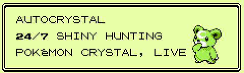

  

# How the Bot Works, in Detail

The [README](README.md) gives the overview, the [FAQ](FAQ.md) the odds. This page goes through every decision the bot makes, with the numbers behind it. The numbers come from the bot's code (file names in brackets), the game's code (the [pokecrystal disassembly](https://github.com/pret/pokecrystal)), and the bot's logs at normal speed.

- [1. Where to Hunt: the Planner](#1-where-to-hunt-the-planner)
- [2. The Roll: Picking a Spot](#2-the-roll-picking-a-spot)
- [3. The Catching Crew: Why Butterfree and Zubat](#3-the-catching-crew-why-butterfree-and-zubat)
- [4. Catching a Shiny, Turn by Turn](#4-catching-a-shiny-turn-by-turn)
- [5. Battles](#5-battles)
- [6. Running From Wild Pokémon](#6-running-from-wild-pokémon)
- [7. Training](#7-training)
- [8. Picking the Team](#8-picking-the-team)
- [9. Healing and Potions](#9-healing-and-potions)
- [10. Money: Joey and the Mart](#10-money-joey-and-the-mart)
- [11. Walking](#11-walking)
- [12. The PC and Evolutions](#12-the-pc-and-evolutions)
- [13. The Odds on the Overlay](#13-the-odds-on-the-overlay)

## 1. Where to Hunt: the Planner

*(`modules/data/hunt_planner.lua`, `goals.lua`)*

### What the bot knows

For every map of the section and every time of day (morning 4-10 AM, day 10 AM-6 PM, night 6 PM-4 AM), the bot has the game's wild table: seven slots at 30/30/20/10/5/4/1%, which Pokémon fills each, and how often a step meets something. From that it knows, for every spot:

- **the share** of encounters each Pokémon makes up there (Gastly is 85% of Sprout Tower at night);
- **the seconds per encounter** at normal speed: 20 seconds for the battle (in, run, out) plus 28 ÷ the encounter rate for the walking. Grass (10%) comes to about 23 seconds, Dark Cave (4%) 27. Sprout Tower is measured at 42 seconds, because the formula said 34 and the logs disagreed.

So every spot makes **shinies per hour** for each Pokémon:

> shinies per hour = 3,600 ÷ seconds per encounter × share ÷ 8,192

A 10% Pokémon on grass: 3,600 ÷ 23 × 0.10 ÷ 8,192 = 0.0019 an hour, one every **22 days** of non-stop hunting.

### What it needs

The goals (`goals.lua`) list every form the section offers and how many shinies that takes. Three shiny Zubat for Zubat, Golbat and Crobat; two Koffing when one becomes the Weezing. Trade evolutions are left out, stone evolutions don't hold up the gym, and an evolved form that a much commoner one turns into is evolved, not hunted (a 1% Weezing comes from a 59% Koffing).

### The plan

The planner hands out each time of day's hours (6 morning, 8 day, 10 night) between the spots open then. The aim: **the slowest Pokémon still needed should be done as soon as possible**, then the next slowest, and so on.

For each Pokémon, its *days* = shinies still needed ÷ shinies a day it gets from the plan. The planner minimises the sum of every Pokémon's days to the **8th power**. The 8th power makes the slowest one count far more than the rest, so it's in effect "make the worst case as fast as it can be", but spare hours still go to whatever is furthest behind. It's solved in 1,500 small steps: each step, for each time of day, the spot that cuts the sum the most gets a little more of that time's hours (the Frank-Wolfe method). Spots left with under 1% of a time of day's hours are dropped.

**One more rule: a time of day's own Pokémon first.** If something still needed only appears at night, the night's hours go to it first; Pokémon met at other times count there only as they come along. The section finishes just as soon either way (the mornings hold it up), but the catches come earlier.

### An example: the start of the first section

| Time of day | Where the hours go |
|---|---|
| Morning (6 h) | Dark Cave 50%, Route 46 43%, Route 31 8% |
| Day (8 h) | Dark Cave 45%, Route 30 29%, Route 31 11%, Route 36 9%, Route 29 5%, Ruins' chamber 1% |
| Night (10 h) | Route 30 34%, Route 31 34%, Sprout Tower 33% |

Why it looks like this:
- **Mornings** are the bottleneck: Teddiursa (5%, Dark Cave) and Phanpy (5%, Route 46) only come out then, so the mornings are split almost evenly between the two.
- **Dark Cave by day** is for Dunsparce: 1% at every time of day, the slowest Pokémon of all.
- **Nights** go where the night-only Pokémon are (Gastly, Hoothoot, Spinarak, Poliwag), and Sprout Tower is there for Gastly: 85% at night, against 5% on the routes.
- **Route 29 gets nothing at night**: its Hoothoot and Rattata are also on better spots.

With this plan the slowest Pokémon finish within about **938 days** on average (Dunsparce 938, Weedle 846, Teddiursa 825, Phanpy 811, Hoppip 760, ...). They're all close together: that's the planner balancing them. Splitting each time of day's hours evenly between its spots instead would take **3,686 days**, four times as long.

The plan is worked out again whenever the needs change, after every catch, so the hours always follow what's still missing.

## 2. The Roll: Picking a Spot

*(`modules/data/hunt.lua`)*

The plan says how many hours a day each spot should get, not when. The bot turns that into a **dice roll**: at each pick, every spot of the current time of day has a chance equal to its share of the planned hours. Morning in the example above: Dark Cave 50%, Route 46 43%, Route 31 8%.

- **When it rolls:** when the time of day changes, after a catch, and after a trip (Pokémon Center, Mart, Joey). Otherwise it **stays**, so it doesn't hop between routes every few minutes. A spot that still has hours in the new plan keeps the bot there.
- **Why a roll and not a timetable:** over weeks the roll gives each spot its planned hours anyway, and the stream gets variety.
- **Waiting for Joey's call:** caves have no phone signal. While the bot is waiting for Joey's rematch call (money for balls), every cave counts only **0.2×** in the roll. By day in the first section, Dark Cave drops from 45% to 14%, and Route 31 goes up from 11% to 17%.
- **What it hunts there, on the overlay:** the Pokémon only found on this map first (Route 29 by day: Sentret), then the ones only out at this time of day, then whatever is furthest behind. The overlay also shows the next rotation ("at 6 PM: Route 31").

## 3. The Catching Crew: Why Butterfree and Zubat

*(`modules/data/team.lua`, `sweet_spot.lua`)*

Catching a shiny needs two things: it has to be **asleep** and its HP has to be **low**, without ever knocking it out. One Pokémon can't do both safely before the first gym, so there are two jobs.

### Why sleep, and why Sleep Powder

The game's catch formula adds **+10 out of 256** for sleep or freeze, and nothing for paralysis, poison or burn (they were meant to add 5, a bug in Gen 2). A sleeping Pokémon also can't attack, can't Teleport away and can't flee. So the catcher's one job is a sleep move.

| | Sleep Powder | Hypnosis |
|---|---|---|
| Accuracy | 75% | 60% |
| Tries until it sleeps, on average | 1.33 | 1.67 |
| Chance it takes 3 or more tries | 6% | 16% |

Every missed try is a turn the shiny can hurt the catcher, and in the wild a turn it could run away or the battle could go wrong. Butterfree learns Sleep Powder at **Lv 15** (Caterpie → Metapod at 7 → Butterfree at 10). Measured over every target before Falkner, a Lv 15 Butterfree loses about 1% of its HP on average before the target is asleep. So the catcher is **always the Butterfree line**: a regular Caterpie is trained to 15, and a shiny Butterfree replaces it once one is caught. Gastly, which knows Hypnosis from the start, was the first idea, but Hypnosis lands 60% of the time against Sleep Powder's 75%.

**Why Butterfree doesn't also weaken:** before Falkner, wild Pokémon go down to **Lv 2**. Their weakest copies have so little HP that a critical hit from almost anything knocks them out, even Butterfree's Confusion. No Butterfree level weakens them all safely, so it's trained only to the first level where it **outspeeds every target** (Lv 15: it acts before a wild Gastly's Hypnosis), and no further.

### Why Zubat

The second job, the **weakener**, needs a move weak enough to never knock out even a Lv 2 target, but one that still hurts everything. The catch: **Gastly is a Ghost**, and Normal moves (Tackle, Scratch) do nothing to it. Zubat's **Leech Life** (Bug, 20 power) does a quarter damage to Gastly. That's tiny, but it's a hit that can't knock it out.

| Candidate | Target levels it can weaken safely (of 45 before Falkner) |
|---|---|
| **Zubat** (Leech Life) | **45** |
| Poliwag | 42 |
| Hoothoot, Rattata, Pidgey, Ledyba, Spinarak, Caterpie | 41 (no Gastly) |

### Why Lv 8, 9 or 10

Zubat is scored over every target level it can weaken safely:

- each level it can handle counts **1 point** if Zubat gets it down to 40% HP in **4 hits or fewer**, less if it needs more (13 hits: 4/13 of a point);
- the bot takes the **lowest level within 2% of the best score**. The curve is flat, and a lower level means less training and less risk of a critical hit knocking out a Lv 2 target.

Its own DVs decide where that lands. A stronger Zubat gets there sooner:

| Zubat's Attack DV | Its level |
|---|---|
| 0-2 | Lv 10 |
| 5-11 | Lv 9 |
| 15 | Lv 8 |

The weakener is **never sent into other fights** (Joey, trainers): the EXP would push it past its level. It only comes in as the last one standing, or to weaken a catch.

## 4. Catching a Shiny, Turn by Turn

*(`modules/data/fighter.lua`, `catch_action`)*

Every turn, in this order:

1. **Not asleep?** The catcher uses its sleep move, as often as it takes. If the shiny wakes up, it's put back to sleep.
2. **Above 40% HP?** Weaken it, but only with a move that **can't knock it out in the worst case**:
   - the **top damage roll** (255/255),
   - a **critical hit** (×2 in Gen 2),
   - **every hit** of a multi-hit move,
   - and **25% on top** as a margin.

   The move also must not poison, burn, confuse or trap the shiny (damage after the turn), or lock ours into using it again. If the one out can't do that, the weakener is switched in.
3. **Else, balls.** The best one in the bag: Ultra (×2), Great (×1.5), Poké (×1), or a Level Ball when the levels make it better. Never a Master Ball.

**Why 40% HP:** the catch formula multiplies by (3 × max HP − 2 × HP) ÷ (3 × max HP). That's a third of the catch rate at full HP, 73% of it at 40%. Lower would be better for the balls, but every extra hit is a risk.

**When no move is safe any more:**
- **A rare Pokémon (5% or less anywhere)**, like Dunsparce, Teddiursa or Phanpy: no risk is ever taken. Balls go at it asleep, whatever its HP.
- **Asleep and at 65% HP or less:** balls rather than risk. A sleeping Pidgey at 60% HP takes a Poké Ball 64% of the time, against 77% at 40%: not worth a knocked-out shiny.
- **A common Pokémon that can't be put to sleep** (no sleep move left): it's weakened the normal way, risking only a critical hit, down to 40%.

Limits against loops: at most 15 weakening turns, 3 in a row that don't bring it lower end the weakening, and at most 40 switches.

## 5. Battles

*(`modules/data/fighter.lua`)*

Every number in a battle comes from the game: types (with Gen 2's chart), the six stats, stat stages, STAB (×1.5), badge boosts, and the damage formula with its random roll (217-255 out of 255, 0.925 on average).

- **The move:** the one that knocks the opponent out in the fewest turns, counting its accuracy. In Gen 2 the *type* decides physical or special: Fire, Water, Grass, Electric, Psychic, Ice, Dragon and Dark use Special Attack, the rest Attack. So Ledian's Bug and Flying moves use its Attack of 35.
- **Stat moves** (Leer, Growl, Swords Dance, ...) only when they save at least one turn, counting a miss as a lost turn, and only when ours lasts that long.
- **Switching:** a switch gives the enemy a free hit, so only when it's clearly worth it:
  - the Pokémon out can't knock the enemy out this turn;
  - another one has a matchup better by more than 0.5 (a matchup is the share of the enemy's HP it takes per turn minus the share of its own it loses, plus 0.5 for striking first with a knockout);
  - and that one takes less than half its HP from the incoming hit.
- **After a faint:** the best matchup of those still standing. The trainer's "change Pokémon?" offer is taken when it helps.
- **New moves** only when they're better: power × STAB × accuracy × hits × the attack stat it uses. Never over an HM move. A sleep move is always learned when it's better than the one it has, in place of the weaker sleep move, or a move that does no damage (String Shot, Harden).
- **Menus are read, not guessed:** which question a YES/NO box asks comes from the game's own routine (learn a move, stop learning, change Pokémon). Anything else is answered NO. Text is moved on with A, never B, because B would cancel an evolution.

## 6. Running From Wild Pokémon

When it isn't catching or training, the bot runs, and it also runs mid-fight when:

- the wild one has a **super-effective move that really hurts**: one expected to take 25% or more of our HP. A Lv 2 Spearow's Peck on Butterfree does 1-2 HP, so that's no reason to run;
- it has a move that can **poison, put to sleep or paralyse** (burn is rare enough to risk);
- **nothing of ours can hurt it**;
- ours is at **25% HP or less**, or out of PP for every damaging move.

Fixed-damage moves (Seismic Toss, Sonic Boom, Super Fang) don't count as super effective: type doesn't change them. The check runs when it appears and again every turn.

## 7. Training

*(`modules/data/fighter.lua`, `modules/play.lua`)*

- **The target:** the next big fight's top level **+2**. Falkner's Pidgeotto is Lv 9, so team members are trained to **Lv 11**.
- **Alone or switch-training:** a trainee fights alone only when all of these hold:
  - its best move, at the lowest roll and without a critical hit, takes at least 25% of the enemy's HP;
  - it wins before losing half its HP;
  - it has the PP;
  - and fighting alone is **more EXP per second** than switch-training.

  Otherwise it **switch-trains**: it leads, and the starter (or another teammate who can win) comes in and finishes the fight, so both share the EXP. The seconds come from the logs: about 6 to find the next one, 5 a turn, 4 for the end of a battle, 7 for a switch, 40 for a Pokémon Center trip.
- **Where:** the grass with the highest-level wild Pokémon at that time of day (the most EXP a battle).
- **The catcher stays put:** once it's at its level, it's never brought in for EXP. More would take the weakener past its safe level, and the catcher past the level it needs.

## 8. Picking the Team

*(`modules/data/team.lua`)*

- **Two specialists**, both shiny catches, picked once Falkner is beaten. Every possible pair is scored on three parts, a third each:
  - **level** (a trained, evolved one counts; a Lv 36 beats a Lv 20);
  - **coverage**: the types the pair and the starter hit for double (+0.35 each), shared weaknesses (−0.5 each), two of the same type (−1.5), one physical and one special (+1), and how strong their final forms are;
  - **rarity**: half of log₂(30 ÷ its best encounter chance): 0 for a 30% Pokémon, 1.3 for a 5% one, 2.5 for a 1% one. A rare shiny beats a common one of the same strength.
- **A new team only when it's 8% better**, so it doesn't swap over small differences. A change means a trip to a Pokémon Center: the PC swap, then training the newcomer.
- **The HM slave** has to learn Cut at least; then a point for each HM the story needs, half for Fly, a quarter for Flash, and a bit for being a weak fighter. In practice: the first shiny Sentret (as Furret), replaced only by a shiny Krabby (as Kingler: Cut, Surf, Strength and Whirlpool).
- **The catcher and weakener** follow their own rules (section 3): the Butterfree line and Zubat only, a shiny replacing a regular one.

## 9. Healing and Potions

*(`modules/data/walker.lua`, `fighter.lua`)*

After every battle, if the lead is under **30% HP** or anyone has a status:

1. **Before the first badge:** the nearest Pokémon Center, always. Cherrygrove and Violet are never far.
2. **In a cave, tower or forest:** a low lead with healthy teammates **fights on**, even if it faints; the walk out costs more.
3. **A Center within 150 steps:** go there.
4. **None that close:** the bag (Antidote, potions).
5. **Still low or poisoned:** the nearest Center, however far.

**Potions in battle**, only in battles it can't or won't run from:
- the one out is at **25% HP or less**;
- the enemy's next hit could knock it out;
- the potion heals **more than that hit takes**. Otherwise it's a turn lost for nothing, again and again;
- at most **3 a battle**.

The potion is the smallest one that fills it up, else the biggest there is. Never Energy Powder or Energy Root (they lower friendship); a Full Restore only when it's all there is. In the first section a teammate that isn't the starter may simply faint near a Center: the Center heals it for free.

## 10. Money: Joey and the Mart

*(`modules/data/joey.lua`, `mart.lua`)*

**Why Joey:** a trainer pays 4 × his class's base × his last Pokémon's level. Joey's rematch (before the Goldenrod flypoint) is a Lv 4 Rattata: 4 × 4 × 4 = **$64**. It's the only money that keeps coming before the first badge.

- His number goes into the phone the first time the bot meets him after beating him.
- When he calls, he wants a rematch **2 times in 3**. That sets a daily flag, gone at the next day's reset, so the bot goes when he calls.
- Calls come about every 25 minutes in places with phone signal (the game's timer runs 20, 10, 5, 3 minutes with a 50% roll each time). With Joey as the only caller, that's up to about **35 rematches a day, ~$2,200**. Once the swarm callers' numbers are in the phone, they share the calls.

**Balls first:**
- the bag is kept close to **99 balls**: as soon as the money above the floor buys a lot of 10, the bot heads for the nearest Mart;
- then Joey's rematches carry on until there's a **$100,000** cushion.

A shiny with a hard catch rate must never meet a near-empty bag.

**At the Mart**, the way a player does it (talk, BUY, item, how many, YES):
- potions up to 5 (any kind counts);
- Antidotes up to 3;
- then Poké Balls with whatever is left;
- never going under **$500**;
- balls alone only when it can get at least 10.

The total the game asks for is checked against the bot's own sum before YES.

## 11. Walking

*(`modules/data/world.lua`, `walker.lua`, `walk_loop.lua`)*

- **The map** is built from the game's own data: every map's blocks and collision, warps, connections, ledges, and the event flags that open the way (Sudowoodo, the badge guard on Route 32).
- **Routes** are planned like a player would walk them: around trainers it hasn't fought, around tall grass when it's not hunting, over ledges only downhill.
- **On every arrival** the walker checks the map data against the game's collision for the tiles around the player, and stops rather than walk on a wrong map.
- **Interruptions** (a phone call, someone stopping you, a door putting it a step off) make it plan again from where it really is. Script text is moved on with B, which never says YES to anything.
- **Hunting** means walking a **loop round the edge of the grass** (or cave floor) where it starts, up to 7×7 tiles, at most 24 steps. Never a door, stairs, a ledge, ice or the edge of the map. Which tiles can give an encounter is the game's own rule (tall grass, long grass, water, and every cave floor tile but ice).

## 12. The PC and Evolutions

*(`modules/data/pc.lua`, `evolve.lua`)*

- **The PC:** deposits first, then withdrawals, only in the current box: changing boxes saves the game, so that prompt is answered only on the bot's own save.
- **Never a release:** in a Pokémon's PC menu (WITHDRAW or DEPOSIT, STATS, RELEASE, CANCEL), A is pressed only with the cursor on the first entry; every YES/NO at the PC is answered NO; and the species under the cursor is checked before anything happens.
- **Evolutions** happen one at a time: the spare copy is fetched from the PC, put in front, and trained where the wild Pokémon are highest-level, until it evolves on its own level-up.
- **The keepers:** the copy of each form that has to stay is stopped with B when it starts to evolve, like a player would. Twins with the same DVs share a fingerprint, so the bot counts how many copies of each stay.
- **Friendship (Crobat):** level-ups and steps raise it, and it evolves on a level-up at 220 or more.

## 13. The Odds on the Overlay

*(`launcher.lua`)*

Everything the overlay calls out comes with its real odds:

| Callout | How it's worked out | Said when |
|---|---|---|
| **Drought** | (8,191 ÷ 8,192)n: the chance to go *n* encounters without a shiny | it passes 1 in 10, 1 in 100, 1 in 1,000 |
| **Lucky shiny** | 1 − (8,191 ÷ 8,192)n, *n* since the last one | 1 in 20 or rarer |
| **Streak** | the shares multiplied: a 50% Pidgey 11 times in a row is 0.511 | it passes 1 in 1,000, 10,000, 100,000, a million |
| **One Pokémon never shiny** | (8,191 ÷ 8,192)its encounters | it passes 20%, 10%, 5%, 1%, 0.1% |
| **DV record** | how many of the 65,536 DV sets add up to that much or more (or less) | 56+ or 4− of 60, about 1 in 936 |
| **Perfect / 0/0/0/0** | 1 of 65,536 each | always |
| **Four of a kind** | 14 of 65,536 (not counting those two): 1 in 4,681 | always |
| **Almost shiny** | Defense, Speed, Special 10, Attack wrong: 8 of 65,536, 1 in 8,192 | always |
| **Milestones** | 10,000 encounters, the 1,000th of one Pokémon, the 5th, 10th, 20th shiny of one | when reached |

After midnight there's a recap of the day: encounters, shinies, Joey's money, and the longest streak with its odds.
