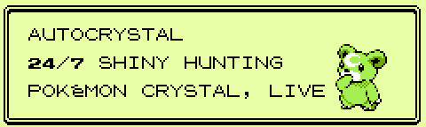
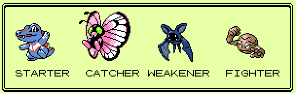

  

  <b>How the bot behind the 24/7 Shiny Hunting stream plays Pokémon Crystal</b> 
  The stream bot is built on <a href="https://github.com/w0px/autocrystal-Shiny-Hunting-Toolkit">autocrystal</a>, the shiny hunting toolkit you can run yourself. 
  Questions? See the <a href="FAQ.md">FAQ</a>.

## Table of Contents

- [The Challenge](#the-challenge)
- [The Ground Rules](#the-ground-rules)
- [How a Section Works](#how-a-section-works)
- [Picking Targets: Where and When to Hunt](#picking-targets-where-and-when-to-hunt)
- [The Team](#the-team)
- [Catching a Shiny](#catching-a-shiny)
- [Battles](#battles)
- [Evolutions](#evolutions)
- [Money and Shopping](#money-and-shopping)
- [Healing](#healing)
- [Getting Around](#getting-around)
- [The PC](#the-pc)
- [Rare Moments](#rare-moments)
- [The Stream and Discord](#the-stream-and-discord)
- [Status](#status)

## The Challenge

A **shiny living dex**, section by section, in a real playthrough of Pokémon Crystal.

The game is split into sections, one per gym. In each section the bot catches a shiny of **every Pokémon it can find there** before it moves on: from the common ones at 30% to the 1% ones that take months. Then it evolves what needs evolving, beats the gym leader, plays the story to the next gym, and starts again.

It's a *living* dex: one shiny for every form. Three shiny Zubat means one stays a Zubat, one becomes a Golbat, one a Crobat.

## The Ground Rules

- **Normal speed.** The game runs at 1x, like on a Game Boy. No fast-forward.
- **Vanilla.** An unmodified English Pokémon Crystal ROM. The bot only presses buttons and reads the game's memory, like a player looking at the screen.
- **No resets.** A shiny that faints or runs away is gone. No retries, no rollbacks, no save scumming.
- **Savestates only for crashes.** If the PC or emulator crashes, the stream carries on from the last automatic save. Never to undo something that happened in the game.
- **Real time.** The game clock follows the real clock, so morning, day and night on stream are morning, day and night where the bot runs.

## How a Section Works

Each section ends at a gym. Inside a section the bot loops:

1. **Story** up to the next gym: the events, trainers and items on the way.
2. **Hunt** until every shiny the section offers is caught.
3. **Evolve** whatever has to be evolved for the living dex.
4. **Beat the gym leader**, then on to the next section.

The first section is everything before Falkner's gym: Routes 29 to 31, Route 36 up to Sudowoodo, the south of Route 46, Sprout Tower, Dark Cave's first room and the Ruins of Alph's inner chamber. That's 45 forms, from Rattata to a 1% Dunsparce.

**Trade evolutions are left out** (Gengar, Golem, Machamp, Alakazam, Politoed, Steelix, ...): the bot plays alone, there's nobody to trade with.

## Picking Targets: Where and When to Hunt

Every Pokémon has its own places and times: Gastly only at night, Teddiursa only in the morning, Dunsparce at 1% in Dark Cave. The bot knows every encounter table of the game, by map and time of day.

- **A plan for the whole section.** The bot works out how many hours of each morning, day and night to spend where, so the section is finished as soon as possible. Every encounter counts, however rare the Pokémon it's still waiting for.
- **Time-only Pokémon first.** If something only shows up at night, the night is spent on it first.
- **A dice roll.** Where to go next is rolled, weighted by the plan. That gives the stream variety, and nothing waits forever.
- **It stays.** The bot re-rolls only when the time of day changes or after a catch, so it doesn't hop between routes every few minutes.
- **Its targets on screen.** The overlay shows the current targets, rarest and map-exclusive ones first, and the next rotation ("at 6 PM: Route 31").

## The Team

  

Six slots, each with a job:

- **The starter** (Totodile) fights the story battles and gym leaders.
- **The catcher** puts the shiny to sleep. Always the **Butterfree line** for its Sleep Powder: a regular Caterpie is trained up until a shiny Butterfree takes over.
- **The weakener** brings the shiny's HP down safely. Always a **Zubat**, trained to the level where it can't knock out even the weakest target with a critical hit. A shiny Zubat replaces the regular one.
- **Two fighters**, both shiny catches from the run. Picked a third each by level, type coverage and rarity, so a rare shiny beats a common one of the same strength.
- **The HM slave** carries the field moves (Cut, Surf, Flash, ...). A shiny always beats a regular one.

The catcher and the weakener are the only jobs a regular Pokémon may do. Everything else is a shiny the bot caught itself. When a better shiny comes along, it takes the job: the bot walks to a Pokémon Center, swaps it in from the PC and trains it.

**Training:** fighters are trained to the next big fight's top level + 2 (Falkner's Pidgeotto is Lv 9, so Lv 11). A trainee fights alone when it wins comfortably, for double EXP, and switches out at the start of a fight otherwise, to share it.

## Catching a Shiny

When a shiny appears:

1. **Sleep.** The catcher uses its sleep move until the shiny is asleep, as often as it takes.
2. **Weaken.** The weakener hits it down to about 40% HP, only with moves that **can't knock it out even with a critical hit and the highest damage roll**. The bot does the game's own damage maths for every hit.
3. **Throw.** The best ball for the moment: Ultra, Great, then Poké Ball, or a Level Ball when the levels allow it. Never a Master Ball.

If the shiny wakes up, it's put back to sleep. If the weakener falls asleep, the bot waits it out or brings in another one. While the shiny can be put to sleep, a critical hit is never risked: no safe hit left means throwing balls.

## Battles

Every battle uses the real numbers from the game: types, stats, stat changes, moves and damage rolls.

- **Best move:** the one that knocks the opponent out fastest, counting accuracy. Stat moves (Leer, Growl, ...) are used when they save a turn and it's safe.
- **Switching:** to a teammate that clearly does better, after a faint to the best matchup, and when the trainer's next Pokémon is a bad match.
- **Running:** from wild Pokémon that are a bad idea. A super-effective move, one that can poison, paralyse or put to sleep, or nothing of ours that hurts it.
- **New moves** are learned only when they're stronger; HMs and the catcher's sleep move are never forgotten.
- **Potions in battle** when the active Pokémon is low and no Pokémon Center is near.

## Evolutions

- **Level evolutions** (Pidgeot at 36, Jumpluff at 27, ...) are trained up before the section's gym.
- **Friendship evolutions** (Crobat) are walked and fought until happy.
- **Stone evolutions** happen when the stone is available. They never hold up a section.
- The Pokémon that has to **stay unevolved** for the living dex is kept from evolving: the bot presses B during the evolution, like a player would.

## Money and Shopping

Money comes from **Youngster Joey**. The bot takes his phone number (and nobody else's), and every time he calls for a rematch it goes to fight his Rattata: **$64** a win. Cave maps have no phone signal, so the bot weighs that in when it's waiting for his call.

- **Poké Balls first.** Once there are fewer than 90 balls and enough money, the bot buys a stack at the nearest Poké Mart, up to 99.
- **Then savings.** With a full bag, Joey's rematches carry on until there's a $100,000 cushion.
- **Supplies.** Five potions and three Antidotes are kept, never Energy Powder or Energy Root (they cost friendship).
- **A floor.** $500 always stays for emergencies.

## Healing

- **Pokémon Center first.** When the lead is low on HP, has a status, or runs out of PP for its attacks or sleep move, the bot walks to a Center.
- **Before the first badge**, it's always the Center: Cherrygrove and Violet are never far.
- **In caves** a strong team fights on: one Pokémon may faint while the others are healthy.
- **Potions and Antidotes** only when no Center is in reach.

## Getting Around

The bot has a map of the whole game, made from the game's own data: every map, every wall, ledge, door, cave and route connection.

- **Routes** are planned like a player would walk them: around trainers it hasn't fought, around tall grass when it's not hunting, and over ledges only in the right direction.
- **Hunting** means walking loops through the grass or cave, not standing still.
- **Story events** are found by their flags in the game's memory, the same way the game knows what has happened.

## The PC

The party has 6 slots, a box has 20. The bot uses **Bill's PC** itself:

- deposits shinies that aren't on the team;
- withdraws the ones it needs, e.g. one set aside to evolve, or a new team member;
- **changes boxes** when one is full. In Gen 2 that saves the game, so the bot answers that prompt only when it's sure it's on its own save.

Releasing Pokémon is never done: every menu step is checked before pressing A.

## Rare Moments

Beyond shinies the bot watches for everything rare and calls it out on the stream overlay:

- **Perfect DVs** (15/15/15/15) and **0/0/0/0**: 1 in 65,536 each
- **Almost shiny:** only the Attack DV kept it from being shiny
- **Four of a kind** DVs, like 7/7/7/7: 1 in 4,681
- **DV records:** the highest and lowest of the run
- **Streaks:** the same Pokémon many times in a row, with the odds
- **Droughts:** no shiny for a long time, and how rare that is
- **Milestones:** 10,000 encounters, the 1,000th Zubat, the 5th shiny Pidgey, ...

## The Stream and Discord

- **The overlay** is drawn in the game's own style: Gen 2 text boxes, fonts and sprites. It shows the current encounter, recent shinies, the wild Pokémon here, the targets, and a log of what the bot is doing and why.
- **Discord:** every shiny, perfect DV and 0/0/0/0 is posted in #shinies the moment it shows up: sprite, DVs, Hidden Power, how often that species has been met, and whether the catch worked. New autocrystal releases are posted there too, and a daily report is coming.

## Status

The bot is in testing: the story up to Sprout Tower, the first section's hunt, the team, catching, the PC, money and evolutions are built. The gym and the sections after Falkner come next.

This repository explains how it works. The stream bot's code isn't here yet: it will follow once it has run long enough on its own.
